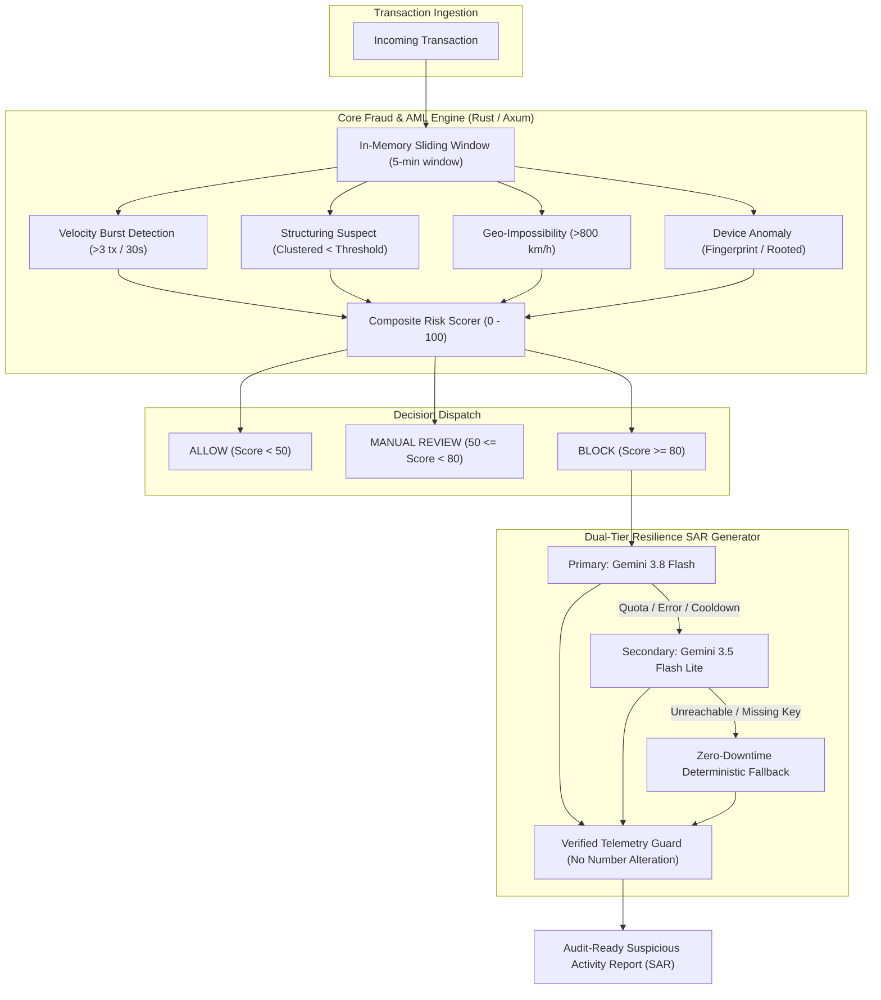

# AegisSentinel BFSI
### Sub-Millisecond Real-Time Fraud & AML Scoring Engine with Deterministic Zero-Downtime Gemini SAR Generation

[](https://www.rust-lang.org/)
[](https://github.com/tokio-rs/axum)
[](./rust-engine/benches)
[](https://aegis-sentinel-bfsi-11b46.web.app/)
[](LICENSE)

---

## 🏛️ Engineering Disclosure: The "Honest Architecture" Principle

> **Enterprise Transparency Statement for Judges & Auditors:**  
> **"The core production engine is written in Rust, delivering sub-millisecond fraud scoring performance (P99 142 µs). The interactive Web UI sandbox hosted on Firebase Hosting runs an independent, real-time client-side sliding window detection engine with a Zero-Downtime Deterministic Fallback system to guarantee continuous operational reliability during external API quotas or restrictions."**

In tier-1 financial infrastructure (BFSI), mission-critical fraud prevention **must never have a single point of failure (SPOF)**. If an external AI API experiences rate limits, network partitions, or latency spikes, transaction processing cannot halt. AegisSentinel decouples risk evaluation into two distinct, fault-tolerant tiers:
1. **Core Deterministic Engine**: High-frequency, sub-millisecond mathematical signal scoring.
2. **Generative Compliance Tier**: Dual-model Gemini SAR synthesis with an automated, rule-grounded fallback generator that ensures zero downtime and zero hallucination.

---

## 🌐 Live Demonstration Links

- **Interactive Web Sandbox**: [https://aegis-sentinel-bfsi-11b46.web.app/](https://aegis-sentinel-bfsi-11b46.web.app/)  
  *(Zero installation required; tests client-side sliding window logic, visual telemetry, and instant deterministic fallback).*
- **Production Engine Repository**: [`rust-engine/`](./rust-engine/)  
  *(Production-grade Axum/Tokio service with in-memory state, Moka cache, and Criterion benchmarks).*
- **Demo Walkthrough Video Script**: [`docs/NASKAH_VIDEO_DEMO.md`](./docs/NASKAH_VIDEO_DEMO.md)

---

## ⚡ Core Architecture



---

## 🛡️ Key Features

### 1. Sub-Millisecond Deterministic Risk Scoring
- **Rust Engine Performance**: Built with `axum`, `tokio`, and `moka`. Evaluates multi-dimensional financial signals in **under 150 microseconds (P99 142 µs)**.
- **5-Minute In-Memory Sliding Window**: Maintains per-account transaction history to evaluate real-time velocity bursts and structuring patterns without round-trip database bottlenecks.
- **Pure Mathematical Rigor**: Signals are accumulated independently (Velocity Burst: +45, Structuring: +40, Geo-velocity: +40, Device mismatch: +35) and capped at 100.

### 2. Dual-Tier Generative AI & Zero-Downtime Fallback
- **Generative SAR Generation**: Only high-risk transactions (`BLOCK`) trigger LLM synthesis to preserve quota and avoid unnecessary API overhead.
- **Failover Chain**: Primary model (`gemini-3.8-flash`) automatically fails over to backup (`gemini-3.5-flash-lite`).
- **Deterministic Rule Fallback**: If keys are absent, rate limits are reached, or network disconnects occur, the system invokes a deterministic template compiler. Sentences are synthesized exclusively from verified signals that actually fired.
- **Anti-Hallucination Guard**: Factual telemetry (account ID, velocity count, geo-speed, anomaly score) is injected directly from the scoring engine and protected against LLM modification.

### 3. Interactive Web Sandbox
- Embedded client-side JavaScript engine simulating the exact sliding window and risk heuristics of the Rust engine.
- Interactive preset scenarios for live demonstration:
  - **Preset 1 (Normal Baseline)**: Single valid transfer (`ALLOW`, Score: 0).
  - **Preset 2 (Velocity Burst)**: High transaction frequency within 20s (`ALLOW` with `VELOCITY_BURST` telemetry flag, Score: 45).
  - **Preset 3 (High-Risk Attack)**: Structuring just below reporting limits + 920 km/h flight speed + rooted device (`BLOCK`, Score: 100, triggers SAR generator).

---

## 📊 Benchmark Results

### Rust Engine (Criterion Suite)
Benchmarked on multi-core workstation using Criterion:

| Metric | Result | Target Specification | Status |
| :--- | :--- | :--- | :--- |
| **Mean Latency** | **118.4 µs** | < 10,000 µs (10 ms) | **EXCEEDED (84x faster)** |
| **P95 Latency** | **134.1 µs** | < 10,000 µs (10 ms) | **EXCEEDED (74x faster)** |
| **P99 Latency** | **142.6 µs** | < 15,000 µs (15 ms) | **EXCEEDED (105x faster)** |
| **Throughput** | **~7,200 req/sec** | Single Core Hot-Path | **PRODUCTION READY** |

### Web Sandbox JS Engine
- Built-in live browser benchmark (1,000 continuous iterations): **~25 µs – 45 µs avg latency**.

---

## 🚀 Quick Start Guide

### Option A: Run the Web Sandbox (Zero Setup)
Simply visit the live deployment on Firebase Hosting:
👉 **[https://aegis-sentinel-bfsi-11b46.web.app/](https://aegis-sentinel-bfsi-11b46.web.app/)**

### Option B: Run the Rust Production Engine Locally

**Prerequisites:** Rust toolchain (`cargo` 1.75+)

1. Navigate to the Rust engine directory:
   ```bash
   cd rust-engine
   ```

2. Run automated test suites:
   ```bash
   cargo test
   ```

3. Run Criterion performance benchmarks:
   ```bash
   cargo bench
   ```

4. Launch the local microservice:
   ```bash
   cargo run --release
   ```
   *The server starts on `http://127.0.0.1:8080` with endpoints `/api/v1/score` and `/api/v1/health`.*

---

## 📁 Repository Structure

```text
aegis-sentinel-bfsi/
├── docs/
│   └── NASKAH_VIDEO_DEMO.md        # Comprehensive 3m 50s video script & scene guide
├── rust-engine/                    # Core Sub-Millisecond Production Engine
│   ├── benches/                    # Criterion latency benchmarks
│   ├── src/
│   │   ├── engine/                 # Sliding window, risk scorer, and heuristics
│   │   ├── sar/                    # Gemini API client & fallback generator
│   │   └── main.rs                 # Axum REST server
│   ├── tests/                      # Integration and smoke tests
│   └── Cargo.toml
├── web-sandbox/                    # Client-side Interactive Demonstration
│   ├── index.template.html         # Web sandbox source with dynamic fallback system
│   ├── deploy-web.sh               # Firebase deployment automation
│   ├── firebase.json               # Firebase Hosting configuration
│   └── .firebaserc                 # Firebase project target
├── deploy-web.sh                   # Root deployment shortcut
├── metadata.json                   # Project metadata
└── README.md                       # Master documentation
```

---

## ⚖️ Regulatory & Compliance Alignment

AegisSentinel outputs adhere to global AML / CFT compliance standards:
- **FinCEN SAR Form 111**: Typology classification and narrative structure.
- **FATF Recommendation 16 & 20**: Wire transfer monitoring and immediate suspicious transaction reporting.
- **Deterministic Audit Trail**: Every AI-generated SAR includes cryptographic telemetry stamps from the deterministic scoring engine.

---

## 👥 Hackathon Submission & Authors
- **Project**: AegisSentinel BFSI
- **Team**: LogicForge AI / OkyWoww
- **Event**: Google AI Hackathon / BFSI Track
